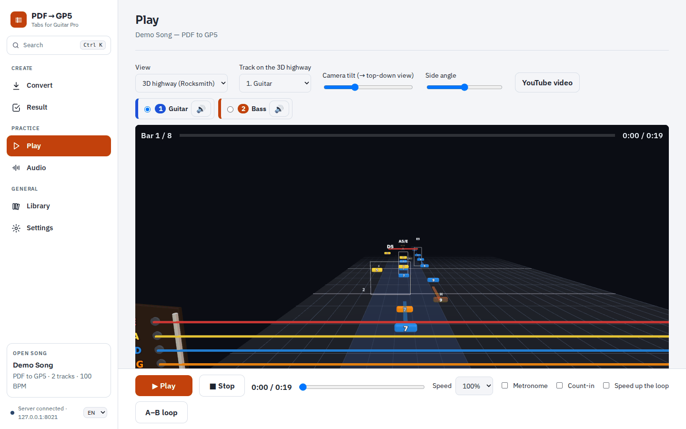

# PDF → GP5

**English** · [Português](README.pt.md)

Turn guitar and bass tablature PDFs — or screenshots of tabs — into **Guitar Pro** files, then
practise them in your browser: notation that plays, a Rocksmith-style 3D highway, the song's audio
and YouTube video in sync, an A–B loop, a metronome and a library of your songs.

[](LICENSE)
[](https://github.com/F100Pilot/PDF-to-GP5/releases/latest)
[](https://github.com/F100Pilot/PDF-to-GP5/actions/workflows/ci.yml)

[](https://paypal.me/F100Pilot)



## Features

- **Reads tabs in many forms**: text tabs (`e|--0--3h5--|`), PDFs exported by Guitar Pro, MuseScore, TuxGuitar or Songsterr, and pictures of tabs (PNG, JPEG, WebP or scanned PDFs, read by OCR on your computer).
- **Finds the song's details**: title, artist, tempo, time signature, tuning, rhythm, techniques (bends, slides, hammer-ons, vibrato, palm mute…), repeats and lyrics.
- **Writes Guitar Pro files**: `.gp5`, or `.gp` (Guitar Pro 7/8) with the song's audio inside. Up to 7 tracks, 4 to 8 strings.
- **Opens Guitar Pro files** (`.gp`, `.gpx`, `.gp5`, `.gp4`, `.gp3`) to play them.
- **Practice player**: staff and tab, 3D highway, speed, A–B loop that can speed up each pass, metronome and count-in.
- **Plays along with the real song**: an audio file or a YouTube video, lined up with the notation.
- **Library** of your songs, with album covers, that you can move to another computer.
- **Portuguese and English** interface.
- **Private**: it runs on your computer, and your files are not uploaded anywhere.

## Get started

You need **Python 3.11 or later** ([python.org](https://www.python.org/downloads/)) and **Google Chrome** (recommended) or Edge.

**Windows**

1. Download the latest version from [Releases](https://github.com/F100Pilot/PDF-to-GP5/releases/latest) (*Source code (zip)*) and extract it.
2. Double-click `start.bat`. On a work PC without administrator rights, or with the folder on OneDrive, use `start_env.bat`.
3. The first run installs what is needed, which takes a few minutes. The app then opens in Chrome at `http://127.0.0.1:8021`.

To quit, close the app window.

**macOS / Linux**

```bash
python3 -m venv .venv
.venv/bin/pip install -r requirements.txt
.venv/bin/pip install --no-deps --ignore-requires-python -r requirements-ocr.txt
.venv/bin/python -m app --port 8021 --close-with-browser
```

Then open `http://127.0.0.1:8021`.

## Documentation

| | English | Português |
|---|---|---|
| User manual | [MANUAL.en.md](docs/MANUAL.en.md) | [MANUAL.md](docs/MANUAL.md) |
| Technical documentation (API, configuration, security, development) | [TECHNICAL.md](docs/TECHNICAL.md) | [TECNICO.md](docs/TECNICO.md) |
| Notes and techniques supported | [NOTATION.md](docs/NOTATION.md) | [NOTACAO.md](docs/NOTACAO.md) |
| YouTube API key (optional) | [YOUTUBE_KEY.md](docs/YOUTUBE_KEY.md) | [CHAVE_YOUTUBE.md](docs/CHAVE_YOUTUBE.md) |
| What's new | [CHANGELOG.en.md](CHANGELOG.en.md) | [CHANGELOG.md](CHANGELOG.md) |

## Support the project

PDF → GP5 is free. If it saves you time, you can buy me a coffee:

[](https://paypal.me/F100Pilot)

Bug reports and ideas are welcome in [Issues](https://github.com/F100Pilot/PDF-to-GP5/issues). See [CONTRIBUTING.md](CONTRIBUTING.md).

## Licence and notices

- The code is under the [MIT licence](LICENSE). The bundled third-party components keep their own licences ([THIRD_PARTY_NOTICES.md](THIRD_PARTY_NOTICES.md)).
- Use the app only with tabs and music you have the rights to use. YouTube's terms do not allow downloading outside YouTube's own features.
- Guitar Pro is a trademark of Arobas Music, and Rocksmith is a trademark of Ubisoft. This project is not affiliated with or endorsed by either.
