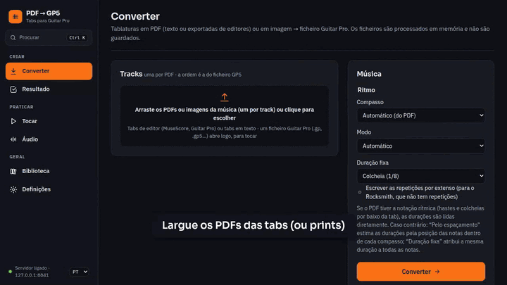

# PDF → GP5

[English](README.md) · **Português**

Transforme tablaturas de guitarra e baixo em PDF, ou prints de tabs, em ficheiros **Guitar Pro**. Depois
pratique-as no browser, com:

- uma partitura que toca;
- uma pista 3D ao estilo do Rocksmith;
- o áudio e o vídeo do YouTube da música em sincronia;
- loop A–B e metrónomo;
- uma biblioteca das suas músicas.

[](LICENSE)
[](https://github.com/F100Pilot/PDF-to-GP5/releases/latest)
[](https://github.com/F100Pilot/PDF-to-GP5/actions/workflows/ci.yml)

[](https://paypal.me/F100Pilot)



## O que faz

- **Lê tabs de várias formas**:
  - tabs em texto (`e|--0--3h5--|`);
  - PDFs exportados pelo Guitar Pro, MuseScore, TuxGuitar ou Songsterr;
  - imagens de tabs (PNG, JPEG, WebP ou PDF digitalizado), lidas por OCR no seu computador.
- **Encontra os dados da música**: título, artista, tempo, compasso, afinação, ritmo, técnicas (bends, slides, hammer-ons, vibrato, palm mute…), repetições e letra.
- **Cria ficheiros Guitar Pro**:
  - `.gp5`, ou `.gp` (Guitar Pro 7/8) com o áudio da música lá dentro;
  - até 7 tracks, de 4 a 8 cordas.
- **Abre ficheiros Guitar Pro** (`.gp`, `.gpx`, `.gp5`, `.gp4`, `.gp3`) para os tocar.
- **Leitor para praticar**:
  - pauta e tab, ou pista 3D;
  - velocidade;
  - loop A–B que pode acelerar a cada volta;
  - metrónomo e contagem.
- **Toca com a música verdadeira**: um ficheiro de áudio ou um vídeo do YouTube, acertado com a partitura.
- **Biblioteca** das suas músicas, com capas, que pode levar para outro computador.
- Interface em **português e inglês**.
- **Privado**: corre no seu computador, e os seus ficheiros não são enviados para lado nenhum.

## Começar

Precisa do **Python 3.11 ou mais recente** ([python.org](https://www.python.org/downloads/)) e do **Google Chrome** (recomendado) ou do Edge.

**Windows**

1. Descarregue a última versão em [Releases](https://github.com/F100Pilot/PDF-to-GP5/releases/latest) (*Source code (zip)*) e extraia-a.
2. Faça duplo clique em `start.bat`. Num PC de trabalho sem administrador, ou com a pasta no OneDrive, use `start_env.bat`.
3. A primeira vez instala o que é preciso, o que demora alguns minutos. Depois a aplicação abre no Chrome, em `http://127.0.0.1:8021`.

Para sair, feche a janela da aplicação.

**macOS / Linux**

```bash
python3 -m venv .venv
.venv/bin/pip install -r requirements.txt
.venv/bin/pip install --no-deps --ignore-requires-python -r requirements-ocr.txt
.venv/bin/python -m app --port 8021 --close-with-browser
```

Depois abra `http://127.0.0.1:8021`.

## Documentação

| | Português | English |
|---|---|---|
| Manual do utilizador | [MANUAL.md](docs/MANUAL.md) | [MANUAL.en.md](docs/MANUAL.en.md) |
| Documentação técnica (API, configuração, segurança, desenvolvimento) | [TECNICO.md](docs/TECNICO.md) | [TECHNICAL.md](docs/TECHNICAL.md) |
| Notas e técnicas suportadas | [NOTACAO.md](docs/NOTACAO.md) | [NOTATION.md](docs/NOTATION.md) |
| Chave da API do YouTube (opcional) | [CHAVE_YOUTUBE.md](docs/CHAVE_YOUTUBE.md) | [YOUTUBE_KEY.md](docs/YOUTUBE_KEY.md) |
| Novidades | [CHANGELOG.md](CHANGELOG.md) | [CHANGELOG.en.md](CHANGELOG.en.md) |

## Apoiar o projeto

O PDF → GP5 é gratuito. Se lhe poupa tempo, pode pagar-me um café:

[](https://paypal.me/F100Pilot)

Erros e ideias são bem-vindos em [Issues](https://github.com/F100Pilot/PDF-to-GP5/issues). Veja o [CONTRIBUTING.md](CONTRIBUTING.md).

## Licença e avisos

- O código está sob a [licença MIT](LICENSE). Os componentes de terceiros incluídos mantêm as suas licenças ([THIRD_PARTY_NOTICES.md](THIRD_PARTY_NOTICES.md)).
- Use a aplicação só com tabs e música que tem direito a usar. Os termos do YouTube não permitem descarregar fora das funções do próprio YouTube.
- Guitar Pro é uma marca da Arobas Music e Rocksmith é uma marca da Ubisoft. Este projeto não é afiliado a nenhuma delas nem tem o seu apoio.
